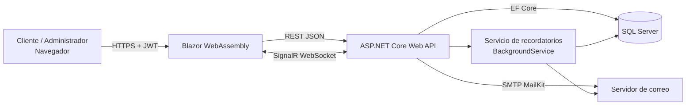

# 1. Introducción

Muchos restaurantes pequeños y medianos gestionan sus reservas por llamadas, mensajes y libretas. Esto genera errores (dos grupos en la misma mesa), tiempo perdido contestando consultas y ninguna estadística sobre la demanda.

Este proyecto construye una **aplicación web** donde los restaurantes publican su perfil (información, menú, horarios y mesas) y los clientes consultan la disponibilidad y reservan en línea. El restaurante revisa las solicitudes en un panel en tiempo real, las acepta o rechaza, y el sistema **automatiza** el resto: calcula la disponibilidad, asigna la mesa, envía el correo de confirmación, manda un recordatorio antes de la visita, pide la calificación después y genera reportes.

# 2. Objetivos

**General.** Automatizar el proceso de reservas de un restaurante, desde la solicitud del cliente hasta la atención.

**Específicos.**

1. Permitir que cada restaurante administre su perfil, menú, horarios y mesas.
2. Mostrar al cliente únicamente horarios con mesa realmente libre y evitar reservas dobles.
3. Ofrecer un panel con listado de reservas, aprobación/rechazo y ocupación en tiempo real.
4. Notificar al cliente por correo (confirmación y recordatorio) sin intervención manual.
5. Medir la operación con reportes exportables y reseñas de clientes.
6. Proteger la información con autenticación, control de acceso y buenas prácticas de seguridad.

# 3. Alcance

**Incluye:** perfiles de restaurantes, reservas en línea, panel de administración, correos automáticos, reseñas, reportes (Excel/PDF), registro de nuevos restaurantes, pruebas unitarias y documentación.

**No incluye (trabajo futuro):** pagos o depósitos, aplicación móvil nativa, integración con calendarios externos, reservas que cruzan la medianoche, multi-idioma.

# 4. Requisitos

## 4.1 Funcionales

| Id | Requisito |
|---|---|
| RF-01 | Listar restaurantes y ver su perfil (descripción, dirección, menú, horarios, capacidad). |
| RF-02 | El cliente consulta horarios disponibles según fecha y cantidad de personas. |
| RF-03 | El cliente crea una reserva y recibe un código único. |
| RF-04 | El cliente consulta o cancela su reserva con el código. |
| RF-05 | El administrador inicia sesión y ve las reservas de **su** restaurante. |
| RF-06 | El administrador aprueba o rechaza (con motivo) reservas pendientes. |
| RF-07 | Al aprobar, el sistema envía un correo de confirmación. |
| RF-08 | El panel muestra ocupación de mesas y se actualiza en tiempo real. |
| RF-09 | El administrador gestiona mesas, menú, perfil y horarios. |
| RF-10 | Recordatorio automático por correo antes de la reserva. |
| RF-11 | El cliente califica su visita (1–5 estrellas y comentario) una vez. |
| RF-12 | Reportes con gráficos y exportación a Excel y PDF. |
| RF-13 | Un restaurante nuevo puede registrarse por sí mismo. |

## 4.2 No funcionales

- **Seguridad:** contraseñas con BCrypt, JWT, roles, bloqueo tras 5 intentos fallidos, limitación de peticiones, cabeceras de seguridad, SignalR autenticado.
- **Integridad:** transacción *Serializable* al reservar; restricciones únicas y *check* en la base de datos.
- **Usabilidad:** interfaz responsiva (móvil y escritorio), mensajes de error claros.
- **Mantenibilidad:** proyectos separados (API, Cliente, Compartido), inyección de dependencias, pruebas unitarias.
- **Disponibilidad:** la API arranca aunque la base de datos falle y expone `/api/health`.

# 5. Arquitectura

La solución tiene tres proyectos más uno de pruebas:

| Proyecto | Responsabilidad |
|---|---|
| `Shared` | DTOs y enumeraciones compartidos entre API y Cliente (un solo contrato). |
| `Api` | Controladores REST, lógica de disponibilidad, seguridad, correo, hub SignalR, tarea de recordatorios, reportes. |
| `Client` | Blazor WebAssembly: páginas públicas y panel de administración. |
| `Tests` | Pruebas unitarias con xUnit. |

# 6. Tecnologías

| Capa | Tecnología |
|---|---|
| Lenguaje / plataforma | C# 12, .NET 8 |
| Backend | ASP.NET Core Web API, EF Core 8, SignalR, Swagger |
| Frontend | Blazor WebAssembly, Bootstrap 5, Bootstrap Icons |
| Base de datos | SQL Server (Express/LocalDB) |
| Seguridad | JWT Bearer, BCrypt.Net, Rate Limiting |
| Correo | MailKit (SMTP) |
| Reportes | ClosedXML (Excel), QuestPDF (PDF) |
| Pruebas | xUnit, EF Core InMemory |

# 7. Módulos

**Disponibilidad.** Genera turnos cada 30 minutos entre la apertura y (cierre − duración de la reserva). Una mesa está ocupada si existe una reserva *Pendiente* o *Aprobada* cuyo intervalo se solapa; rechazar o cancelar libera la mesa. Se asigna la mesa más ajustada a la cantidad de personas.

**Reservas.** La creación corre en una transacción *Serializable* para impedir que dos clientes tomen la misma mesa. Cada reserva recibe un código aleatorio de 8 caracteres.

**Panel de administración.** Dashboard con reservas, filtros, aprobación/rechazo y ocupación de mesas. Un aviso de SignalR hace que todas las pantallas del restaurante se refresquen al instante.

**Correo.** Confirmación al aprobar y recordatorio previo. Si no hay SMTP configurado, el correo se registra en el log (modo simulado) y la aplicación sigue funcionando.

**Recordatorios.** Un `BackgroundService` revisa cada 10 minutos las reservas aprobadas que empiezan dentro de las próximas 24 horas y envía un recordatorio una sola vez (`RecordatorioEnviado`).

**Reseñas.** Solo reservas aprobadas, después de la hora de la visita y una por reserva. Se muestra el primer nombre del cliente por privacidad.

**Reportes.** Totales por estado, tasa de aprobación, personas atendidas, calificación media y gráficos por día, hora y día de la semana; exportables a Excel y PDF.

# 8. Seguridad

| Amenaza | Medida |
|---|---|
| Robo de contraseñas | Hash BCrypt; política de contraseñas (8+, mayúscula, minúscula, número). |
| Fuerza bruta | Límite de peticiones por IP en login (8/min) y bloqueo de cuenta 15 min tras 5 fallos. |
| Acceso a datos de otro restaurante | El `rid` del JWT define el restaurante; nunca se acepta del cliente. |
| Espionaje en tiempo real | Hub de SignalR exige JWT con rol Admin y verifica el restaurante. |
| Abuso de endpoints públicos | Rate limiting (30/min) y registro limitado (5/hora). |
| Enumeración de usuarios | Mensaje único "correo o contraseña incorrectos". |
| Clic-jacking / sniffing | `X-Frame-Options`, `X-Content-Type-Options`, `Referrer-Policy`. |
| Configuración insegura | La API no inicia en producción con la clave JWT de ejemplo. |
| Fugas por errores | Manejo global de excepciones: el cliente recibe un mensaje genérico, el detalle va al log. |

# 9. Pruebas

Las pruebas unitarias (`tests/ReservasRestaurantes.Tests`) cubren la lógica de mayor riesgo con un reloj simulado (`TimeProvider`) para ser deterministas:

- Disponibilidad: día cerrado, 20 turnos, solapamientos, reservas rechazadas/canceladas, capacidad insuficiente, horas pasadas.
- Política de contraseñas.
- Cálculo de reportes.

Ejecución: `dotnet test`.

# 10. Conclusiones

El sistema automatiza el ciclo completo de una reserva y reduce errores humanos: evita dobles reservas, avisa al cliente sin intervención y da datos al restaurante para decidir. La separación en capas y las pruebas facilitan mantenerlo y ampliarlo.

# 11. Trabajo futuro

- Migraciones de EF Core y despliegue en la nube (Azure / contenedores).
- Pagos o depósito de garantía para reducir ausencias.
- Notificaciones por WhatsApp o SMS.
- Lista de espera automática cuando se cancela una reserva.
- Subida de imágenes del restaurante y roles adicionales (anfitrión, gerente).
