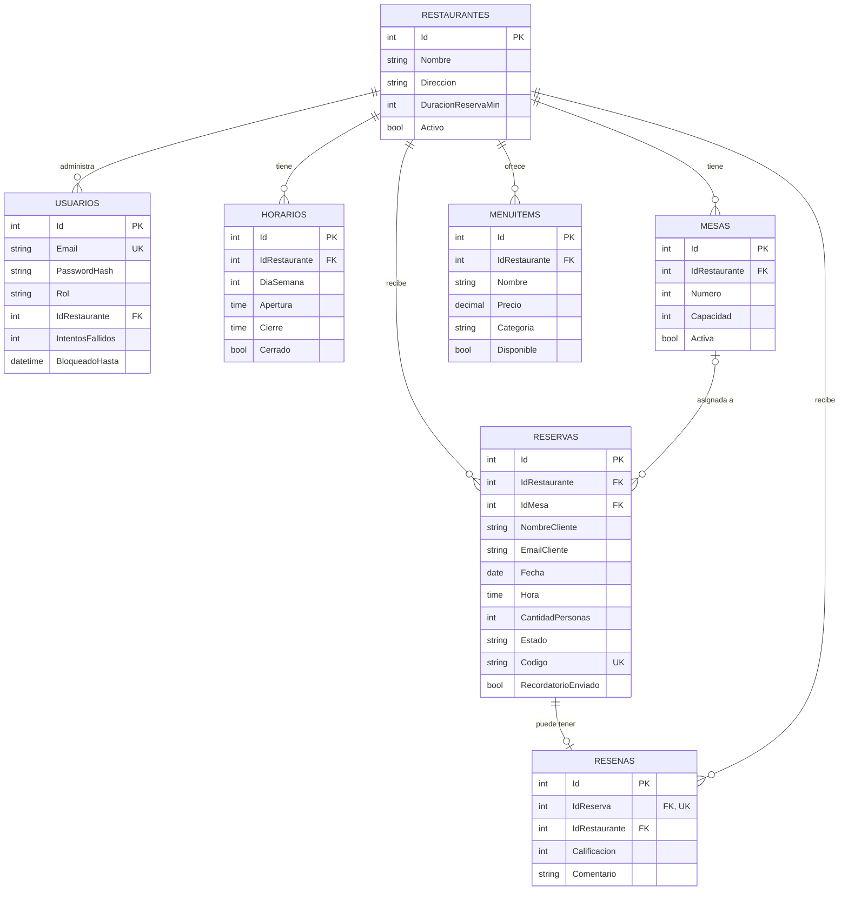

# Diagrama entidad-relación

# Diccionario de datos

## Restaurantes
| Campo | Tipo | Descripción |
|---|---|---|
| Id | INT PK | Identificador. |
| Nombre, Descripcion, Direccion, Telefono, Email, ImagenUrl | NVARCHAR | Datos del perfil público. |
| DuracionReservaMin | INT | Minutos que una reserva ocupa la mesa (por defecto 90). |
| Activo | BIT | Si aparece en el listado público. |

## Usuarios
| Campo | Tipo | Descripción |
|---|---|---|
| Email | NVARCHAR(150) UNIQUE | Usuario de acceso. |
| PasswordHash | NVARCHAR(200) | Hash BCrypt. |
| Rol | NVARCHAR(20) | `Admin`. |
| IdRestaurante | INT FK | Restaurante que administra. |
| IntentosFallidos | INT | Fallos de login seguidos. |
| BloqueadoHasta | DATETIME2 NULL | Cuenta bloqueada mientras sea futuro. |

## Horarios
Uno por día de la semana (0 = domingo … 6 = sábado): `Apertura`, `Cierre`, `Cerrado`.

## Mesas
`Numero` (único por restaurante), `Capacidad`, `Activa`.

## MenuItems
`Nombre`, `Descripcion`, `Precio`, `Categoria`, `Disponible`.

## Reservas
| Campo | Tipo | Descripción |
|---|---|---|
| IdMesa | INT NULL FK | Mesa asignada automáticamente. |
| NombreCliente, EmailCliente, TelefonoCliente | NVARCHAR | Datos del cliente. |
| Fecha, Hora | DATE, TIME | Momento de la visita. |
| CantidadPersonas | INT (1–20) | Tamaño del grupo. |
| Estado | NVARCHAR | `Pendiente`, `Aprobada`, `Rechazada`, `Cancelada`. |
| Codigo | NVARCHAR(12) UNIQUE | Código para consultar/cancelar/calificar. |
| RecordatorioEnviado | BIT | Evita enviar el recordatorio dos veces. |

## Resenas
`IdReserva` (UNIQUE: una por reserva), `IdRestaurante`, `Calificacion` (1–5, CHECK), `Comentario` (≤ 500), `Fecha`.

# Reglas de integridad destacadas

- `UQ_Usuarios_Email`, `UQ_Reservas_Codigo`, `UQ_Resenas_Reserva`.
- `CK_Res_Estado`, `CK_Res_Personas`, `CK_Resena_Cal`.
- Índice `IX_Reservas_Rest_Fecha` para calcular disponibilidad y reportes rápidamente.

# Scripts

| Archivo | Uso |
|---|---|
| `01_schema.sql` | Crea la base y todas las tablas (idempotente). |
| `03_datos_demo.sql` | Restaurantes, mesas, menús y administradores de ejemplo. |
| `04_actualizacion_v2.sql` | Agrega reseñas, recordatorios y bloqueo a una base antigua. |
| `ReservasDB_completa.sql` | Esquema + datos demo en un solo archivo. |
| `02_consultas_utiles.sql` | Consultas de apoyo. |
